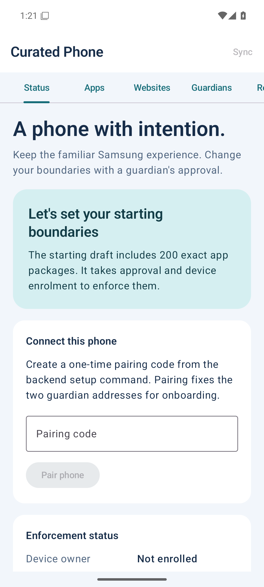

# Curated Phone

A native Samsung settings controller with guardian-approved changes. It keeps One UI, allows apps by default, and applies an exact app blocklist through Android device policy and Samsung Knox. Kotlin/Compose, Room, Convex, and the official Resend component.

**This is a working development build with explicit hardware validation gates. It is not ready to manage your everyday phone.** The Android app, approval backend, build tooling, and tests are implemented. Samsung Knox licensing, large category filtering, production enrolment, and complete ownership release need the checks in [BLOCKERS.md](docs/BLOCKERS.md).

[Download the signed v0.1.0 prototype](https://github.com/AntonVerhasselt/curated-phone/releases/tag/v0.1.0).



## What is implemented

- Status, apps, websites, guardians, exact review, OTP, history, and removal screens.
- A fixed initial draft of 200 blocked packages: five social/video apps and 195 browsers. Stable Chrome and essential packages remain protected. No automatic browser feed or default-deny installation rule.
- Offline draft persistence, Android Keystore encrypted credentials, excluded backups, versioned signed policies, and a durable application journal.
- Device-authenticated HTTPS pairing and request APIs. There are no public policy mutations or unauthenticated device queries.
- Eight-digit OTPs, ten-minute expiry, five attempts, generation-bound resends, hourly email and verification limits, atomic consumption, and recoverable signed approvals.
- Initial verification of both guardian inboxes. Primary-approved address changes and standalone recovery replacement of the primary. Recovery cannot change settings or remove management.
- P-256 SHA-256 signatures over the transmitted UTF-8 bytes, using DER signatures compatible with Android `SHA256withECDSA`.
- Device-owner protection, suspension, Chrome managed rules up to 1,000 entries, Knox integration with exact readback, and guarded removal cleanup.
- HTTPS category-feed downloads, licence/source approval, bounded downloads, checksums, last-known-good cache, and refresh work. Large lists fail visibly instead of truncating.
- Separate development/production deployment configuration, private stable release signing, MIT licence, GitHub checks, and exported Room schema.

## Local setup

On this machine the repository is `~/Projects/curated-phone`, the SDK is `~/Android/sdk`, and JDK 21 is installed through mise. Tool paths and deployment details are recorded in [setup.md](docs/setup.md).

```bash
cd ~/Projects/curated-phone
export JAVA_HOME="$(mise where java@temurin-21)"
export ANDROID_HOME="$HOME/Android/sdk"
export PATH="$ANDROID_HOME/platform-tools:$PATH"
cd backend
npm ci
npm test
npm run typecheck
npx convex dev
```

For a new Linux machine, run `scripts/setup-linux.sh` from the repository root. Open `android/` in Android Studio. The Gradle wrapper and pinned dependency catalog are committed. Do not copy private `.secrets/` content into Git.

From a second terminal at the repository root:

```bash
export JAVA_HOME="$(mise where java@temurin-21)"
export CURATED_APPROVAL_PUBLIC_KEY_FILE="$PWD/.secrets/development/approval-public-key.pem"
android/gradlew -p android :app:assembleDebug :app:testDebugUnitTest :app:lintDebug
adb -s YOUR_TEST_SERIAL install -t -r android/app/build/outputs/apk/debug/app-debug.apk
```

Debug builds are `testOnly` and share the final package ID; their signing identity differs from release. Use a separate disposable device/emulator. Do not enrol a daily-use phone with debug signing.

## Connect email and guardians

See the detailed [.env.example](.env.example) and [operations.md](docs/operations.md). Backend environment values belong in Convex, not the APK. `.env.example` is a reference; Gradle does not automatically read it.

1. Verify a sending domain in Resend; set `RESEND_API_KEY`, `EMAIL_FROM`, and `RESEND_WEBHOOK_SECRET` in the selected deployment.
2. Keep `RESEND_TEST_MODE=true` for test inboxes. Set it to `false` only when real guardian delivery is configured.
3. Generate a pairing code through the authenticated operator CLI. This internal setup action is not a phone-accessible API:

```bash
cd backend
npx convex run cryptoActions:createPairing \
  '{"label":"Anton’s Samsung","primaryEmail":"primary@example.org","backupEmail":"backup@example.org"}'
```

The displayed pairing code expires in ten minutes and is consumed once. Enter it on Status. Create a policy draft, configure tested licensed category feeds, review it, and request approval. Initial setup requires primary authorization and recovery-inbox verification. The guardian must own the inbox; the controller never retrieves their code.

Adding a feed source requires approval. Feed files must contain one ASCII/punycode domain per line, optional `#` comments, no adblock syntax, paths, IP addresses, or wildcards. A maintained source with verified category coverage and acceptable terms has not yet been selected. Turning all categories off is possible only as an explicitly reviewed and approved policy.

## Management and release

Use the [device test matrix](docs/device-test.md) before relying on enforcement. An ordinary installed APK is not a device owner. A successful ADB enrolment on an emulator does not establish Samsung production eligibility.

Obtain the Knox SDK/licence from Samsung and place `knoxsdk.jar` in `android/app/libs/`; the proprietary SDK is excluded from Git. Activate the licence on-device. The adapter uses runtime SDK calls so the app can build without redistributing Samsung binaries. Unsupported calls never report success.

Read [release.md](docs/release.md) to build with the stable signing identity and production verification key. Both validation flags remain false until the exact Samsung acceptance tests pass. Removal refuses to weaken restrictions before a complete release route is validated; it never automatically wipes the phone.

## Documentation

- [Original briefing](docs/implementation-plan.md)
- [Setup and deployments](docs/setup.md)
- [Architecture and protocol](docs/architecture.md)
- [Configuration and operations](docs/operations.md)
- [Release signing](docs/release.md)
- [Implementation coverage](docs/briefing-coverage.md)
- [Recorded validation](docs/validation.md)
- [Device acceptance matrix](docs/device-test.md)
- [Blockers and remaining gates](docs/BLOCKERS.md)

MIT covers this repository's original code. Android, Kotlin, npm dependencies, external feeds, and Samsung SDK remain subject to their own licences. No banking credentials, guardian emails, OTPs, private signing keys, or licence keys are included.
